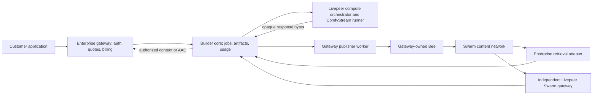

# Swarm publishing and retrieval through the builder gateway

Status: proposed implementation design, 31 October 2026. No runtime behavior changes
in this branch. Based on `origin/releases/m3` at `e69c85a`.

## Product and ownership

The customer buys compute, content publication and delivery from an enterprise
gateway. The gateway embeds builder-core (or calls its authenticated REST service).
Builder-core executes the paid compute job, persists publication operations, moves
bytes through storage adapters, and reports usage and network-cost evidence. The
enterprise application owns quotes, customer credit, retail prices and invoices.
This preserves the existing [architecture](../../ARCHITECTURE.md) and
[core beliefs](core-beliefs.md). Calling the deployment a “gateway that sells
bandwidth” does not put customer billing inside the noncommercial engine.

The preferred publishing path bypasses the publishing orchestrator: the engine
uses a gateway-operated publisher worker and private Bee directly. Compute still
runs on Livepeer. Retrieval can be served by the enterprise's own Bee or purchased
from an independent Livepeer gateway capability. Neither path requires customers
to manage a Bee node wallet.



The existing deployed services remain available:

| Service | Role | Default in this proposal |
| --- | --- | --- |
| `livepeer-example/swarm-publish-demo` on eliteprd1 | Optional network-hosted publication | Available, not required for direct publication |
| `livepeer-example/swarm-aac-gateway` on eliteprd4 | Independently priced decentralized AAC retrieval | Optional delivery provider, explicitly selected |
| Gateway publisher worker | Direct batch/live publication using the gateway's Bee | Preferred publication provider |
| Gateway retrieval worker | Own Bee, bounded caching, HTTP result delivery and AAC playback | Preferred enterprise delivery provider |

Leaving both network capabilities deployed does not turn the bounded paid test
broadcast into an indefinite paid session. This design creates no new funding,
postage purchase, transfer, or paid workload.

## Verified integration points and current limits

| Existing code | What can be used now | What is not implemented today |
| --- | --- | --- |
| `services/jobs.py`, `services/streams.py` | `engine.jobs.streaming.stream(actor, request)` opens an owned byte iterator with status, content type and headers | Automatic result retention or Swarm publication |
| `protocols/__init__.py` | `StreamingRunnerTransport.open`, `RunnerStream.__aiter__`, `aclose` | Artifact and Swarm provider ports |
| `adapters/runner_call.py` | Native paid HTTP requests and binary response streaming | Swarm chunking, postage and feed writes |
| `contracts/jobs.py` | `ResultRef`: content type, byte count and SHA-256 | `storage="stored"` remains reserved for retained/async results |
| `http/app.py`, `http/streaming.py` | Authenticated `POST /v1/jobs?stream=true` forwards arbitrary response bytes | Browser-renderable retained result endpoints |
| `services/reserved.py` | Explicit 501 behavior for unimplemented persistent session features | General realtime session ownership and proxy lifecycle |
| `store/`, operation references | Durable jobs, attempts, payment evidence and repeat-safe command patterns | Publication outbox, artifact manifests and Swarm usage records |

The existing byte iterator is the right attachment point for a batch image result.
It is not a durable asynchronous job queue, nor a persistent realtime session API.
See [streaming decisions](m3-decisions.md),
[result access guide](m3-guides/iss-15-history-and-results.md),
[async job guide](m4-guides/iss-26-async-jobs.md), and the
[native HTTP plan](../exec-plans/active/native-http-transport.md).

## Implementation boundaries

Start with an optional companion package, provisionally `livepeer-builder-swarm`,
and an enterprise gateway composition example. Do not import the demo runner HTTP
server into engine services. Reuse the tested Swarm crypto, feed and radio code
through pinned adapter dependencies, with runtime wiring supplying protocols.

The companion has two deployment modes: in-process for development and a separate
worker for production isolation. In both, the enterprise API owns customer access;
Bee's write/admin API stays private. The worker receives scoped operations, byte
streams and signing callbacks, never an unbounded general-purpose proxy request.

After contract review, add these engine extension points:

| Proposed layer/file | Responsibility |
| --- | --- |
| `contracts/artifacts.py` | Frozen artifact, publication, delivery and usage records |
| `protocols/artifacts.py` | `ArtifactPublisher`, `ArtifactReader`, `ArtifactStore`, `PublicationSigner`, `UsageSink` |
| `services/artifacts.py` | Actor ownership, admission, idempotency, publication lifecycle and delivery limits |
| `adapters/swarm.py` | Optional companion adapter boundary only; isolate Swarm/HTTP dependencies here |
| `store/artifacts.py` and migrations | Durable operations, artifact references, receipts and usage outbox |
| `runtime/engine.py`, `api.py` | Optional `artifacts` facade and dependency injection; imported/REST parity |
| `http/artifacts.py` | Thin authorized upload, lookup and content-stream endpoints |
| `testing/` | Fakes for pending, uncertain, exhausted-batch and slow-reader outcomes |

Module names and signatures here are proposals, not public contracts. Update the
layer/dependency structural tests deliberately when adding the optional adapter;
do not spread `aiohttp`, SDK or Swarm imports into services. Baseline installs must
not require Bee, FFmpeg, PyAV, a wallet or a running worker.

## Batch outputs: ComfyStream text to image

1. The enterprise authorizes the customer, reserves a retail budget and provides an
   actor, operation reference, output policy and publication budget to the engine.
2. The engine opens the existing streaming job. The ComfyStream workflow should
   return final `image/png` or `image/jpeg` bytes for the first implementation.
   Transport chunks are arbitrary byte fragments, not complete images or artifacts.
3. A publication coordinator consumes the iterator once, increments a SHA-256 and
   byte count, and writes a bounded durable spool while constructing Swarm chunks.
   Never accumulate the entire result in RAM, a JSON/base64 envelope or a DB column.
   Admission reserves spool capacity; an initial configurable limit is 256 MiB per
   artifact, 64 KiB I/O blocks, eight uploads in flight, and an aggregate disk quota.
   These are proposed defaults requiring workload validation.
4. Commit postage allocation before requesting/returning signatures. Push chunks
   through the gateway Bee with externally supplied stamps and immediate upload.
   For large outputs, implement an incremental BMT tree with a bounded frontier;
   the current example's whole-buffer `pyramid()` is not a large-file streaming API.
5. EOF, a successful runner response, verified size/hash and successful chunk
   acknowledgments complete the artifact. Persist its final Swarm reference and
   publication receipt atomically before exposing it as ready. Bee acknowledgment
   is a publication receipt, not a perpetual availability guarantee; an independent
   read verification can promote delivery status from unverified to verified.
6. Link the artifact to the already-executed job. A failed Swarm write must not
   redispatch paid image generation. Retrying publication reads the retained spool.
7. Return an artifact record and an enterprise-controlled delivery URL. The UI can
   render it in an image element or offer download, subject to its authorization mode.

First MVP: retain and publish a complete binary image body. For several images,
use an explicit bounded multipart/artifact manifest contract with each part's media
kind and length. A ComfyStream-specific integration adapter translates its events,
URLs or containers into artifacts outside the generic engine. Do not mistake SSE
progress, a JSON URL envelope, an HTTP error page or an unfinished multipart response
for a successfully generated image. Fetching a result URL requires explicit egress,
redirect, size and expiry policy; do not follow arbitrary runner-provided URLs by default.

The current stream's disconnect semantics remain intact. The connected MVP abandons
its runner stream if its owning request is canceled. “Continue after the browser
closes” requires an explicitly admitted durable worker and the ISS-26 lifecycle;
changing who owns the stream must not silently override D30/D34/D36. A private
preview tee is optional later: its queue is bounded and a slow preview never stalls
retention; preview bytes are not a committed artifact.

## Realtime publication

A distinct `PublicationSession` owns the station, fresh broadcast topic, signer,
postage allocation lease, capture/ingest limits and publication worker. It does not
pretend a finite `JobStream` is an unlimited persistent session. Introduce it with
reviewed session lifecycle semantics alongside ISS-27; generic engine session APIs
keep their existing 501 behavior until that work is implemented.

For audio, reuse two-second AAC-LC/fMP4 segments, actual durations and continuous
timestamps. Signing, media ingestion, Bee upload and feed publication run as
independent bounded tasks. Keep no more than three unpublished segments; dropping
stale unpublished audio creates an explicit timeline discontinuity. Publish media
before playlists, and playlists before station announcements. Feed updates and
postage use the publisher identity, independent of the Livepeer payer.

The direct worker replaces the orchestrator hop, not the signing protocol. A remote
publisher signer receives correlated operation/session/request IDs and exact chunk
addresses derived from submitted content. With a local signer adapter, the same
checks happen in-process. A signer that has not received the content or an authorized
content commitment must not blindly sign arbitrary worker-supplied hashes.

Retain SQLite/Postgres allocation state and exact pending feed commands. Hold one
exclusive writer lease per batch with fencing across workers. A retry of an uncertain
feed write repeats the identical body, signature and index. Never reset used counters,
reuse a stamp slot accidentally, advance a confirmed feed index before acknowledgment,
or recover from a stale counter backup without reconciliation. Mutable batches require
explicit overwrite/retention policy: published references do not imply indefinite storage.

## Signing identities and funding

| Identity | Role | Secret location |
| --- | --- | --- |
| Livepeer payer | Compute or optional network-gateway payments | Existing payment credential/SecretStore |
| Content publisher | Postage and feed signatures; postage must recover to batch owner | User signer or explicitly delegated `SecretRef` |
| Gateway Bee operator | Bee identity, SWAP chequebook, bandwidth funding | Operator-controlled Bee keystore |
| Customer actor | Authorization, tenant ownership, retail account | Enterprise identity provider |

Actor IDs are not wallet addresses. Bind signing authority to the authorized actor
and batch through an explicit grant. Allow a user-supplied funded batch or a separately
quoted, explicitly provisioned service-managed batch. Service-managed postage is signed
by that batch's owner; it cannot impersonate a customer's publisher wallet.

Customers need no Bee wallet and the Livepeer payer needs no BZZ. The operator funds
its own Bee. Batch acquisition, top-up, delegation, chequebook deposits and key rotation
are explicit administrative operations, with idempotency keys and spend caps. They do
not occur as hidden side effects of publishing or viewing an artifact.

## Retrieval and rendering

Expose an actor-authorized artifact identifier, not a credential-bearing Bee URL.
Proposed routes, all subject to contract review:

| Route | Purpose |
| --- | --- |
| `POST /v1/artifacts/publications` | Admit upload or attach an authorized job result with an operation reference |
| `GET /v1/artifacts/{id}` | Metadata, provenance, storage reference and publication/availability state |
| `GET /v1/artifacts/{id}/content` | Authorized byte stream with validated media type, length and range semantics |
| `POST /v1/publication-sessions` | Admit bounded realtime publication |
| `POST /v1/playback-sessions` | Choose local Bee or a network gateway under explicit ceilings |
| `GET /v1/playback-sessions/{id}/stream.aac` | Authorized AAC stream without exposing paid upstream channel tokens |

For authenticated browser images, use an application session cookie, a short-lived
scoped delivery grant, or fetch-to-blob; an image element cannot attach an arbitrary
bearer header. Grants bind artifact, tenant, expiry and optional byte/range budget;
refresh/revocation belongs to the enterprise access layer. Support GET/HEAD and a
single byte range first; validate 206/416 and content lengths, and meter only actual
body writes. Cancel Bee reads and release reservations when clients disconnect.

Verify Swarm references and SOC owners. Do not describe a partially fetched range as
whole-object hash verified: use verified chunk proofs/tree traversal or fetch and
verify the complete bounded object before returning ranges. Track verification state.
Serve executable/unknown content as attachments with `nosniff`; render approved
images on a restricted content origin. MIME claims from runners alone are not proof
that arbitrary HTML is safe to embed.

Local AAC retrieval reuses the independent discovery, bounded prefetch and playback
pipeline from `livepeer-swarm-radio`. Cache immutable chunks by reference and maintain
bounded authenticated feed frontiers. Meter retrieval and delivery separately. Cache
hits have no new Bee read but still consume enterprise egress. Sharing a station
pipeline across customers must preserve per-listener authorization and delivery usage.

The network option reserves `livepeer-example/swarm-aac-gateway` through an injected
session provider with a price ceiling and maximum duration. Builder-core proxies
its output under the customer's authorization; it does not reveal the upstream
session URL (D9). The capability currently supplies AAC only. It cannot retrieve
arbitrary generated images: generic byte retrieval needs a separately named, reviewed
network capability, while direct Bee retrieval supports batch artifacts in the MVP.
Automatic fallback between local and paid network retrieval is disabled by default;
a fallback may spend only under an explicit provider/budget policy.

## Commercial usage and wholesale cost

The gateway can sell publication and retrieval with separately disclosed service
rates, bundled into a subscription or quoted per operation. The engine supplies
usage/evidence, not the retail invoice or an assertion that this model is profitable.

Proposed usage events carry unique `event_id`, `application_id`, `actor_id`, operation,
artifact/session ID, direction, quantity/unit, interval, provider, evidence status,
and a monotonic per-operation sequence. Commit an outbox row with the corresponding
operation transition. Delivery retries deduplicate by event ID at the enterprise
consumer; on uncertainty retain a pending estimate instead of inventing zero.

| Meter | Meaning |
| --- | --- |
| Accepted publication bytes | Logical customer payload, counted once per artifact |
| Uploaded network bytes/chunks | Actual Bee work, including retries, with evidence |
| Origin retrieval bytes | Bee/network bytes fetched, distinct from cache hits |
| Customer delivery bytes | Body bytes accepted by the serving transport, not proof of human consumption |
| Live session duration | Monotonic active time under an admitted session |
| Livepeer cost | Existing ticket/payment evidence, unchanged |
| Swarm cost | xBZZ settlements, gas and explicit postage allocations, with observation interval |

Represent money with `Decimal` and explicit currency/unit. Keep xBZZ, xDAI and
Livepeer cost sources separate, with FX source/time when an application prices them
in fiat. A chequebook deposit is funding, not consumed bandwidth. A postage purchase
is not automatically the cost of one request; allocation and expiry are explicit.
SWAP settlements are batched and node-wide. Do not claim exact per-customer bandwidth
cost from a balance delta on a shared Bee. Report node-level evidence plus separately
labeled attribution/estimate policy; dedicated nodes provide stronger attribution.

The enterprise reserves retail credit before admission, uses a snapshotted tariff
and authorizes cancellation/extension. Publish retry must not charge the logical
artifact twice. Whether actual retry bandwidth is billable is a disclosed tariff
policy, not an engine guess. Retrieving through the network capability adds its
Livepeer charge; do not count that charge again as an independently observed Bee
cost already included in the provider's price.

## Durable state and failure semantics

Proposed new tables (migration names allocated at implementation time):

- `artifacts`: ownership, originating job/attempt, verified media type, byte count,
  SHA-256, Swarm reference, encryption metadata references and availability state.
- `publication_operations`: unique tenant/actor/operation reference and fingerprint,
  state, spool reference, exact intended root, attempt counters and receipts.
- `publication_chunks`: upload evidence and retry state; bounded retention or a
  compact bitmap/manifest for large artifacts rather than unbounded per-byte rows.
- `publisher_batches`, `stamp_allocations`, `feed_writes`: batch identity/lease,
  monotonically committed allocations and exact pending/confirmed signed commands.
- `delivery_sessions`, `content_usage_outbox`: admission, deadlines, usage sequence,
  checkpoints and idempotent export state. Store no plaintext keys or bearer tokens.

```text
admitted → receiving → sealed → publishing → published
                         ↘ retryable / uncertain / terminal_failure
```

Job execution state and publication state are separate. A succeeded compute job can
have a retryable publication. A ready artifact requires complete bytes and a committed
publication receipt. Do not use reserved `ResultRef.storage="stored"` prematurely:
initial integration attaches an artifact via the new registry; the reviewed retained
result contract can later link `ResultRef.location` to an engine artifact URI.

| Failure | Required behavior |
| --- | --- |
| Runner truncates/errors after payment | Preserve existing uncertain/failed job evidence; no ready artifact |
| Browser disconnects during connected MVP | Close owned stream, retain existing abandoned semantics; partial artifact not published as ready |
| Compute succeeds, Bee fails | Keep sealed spool and publication retry; never rerun compute |
| Bee accepted bytes but acknowledgment lost | Mark uncertain; verify reference/retry identical authorized content |
| Crash after stamp reservation | Allocation remains consumed; no reuse on restart |
| Crash after publication before UI response | Operation lookup returns the same committed artifact |
| Postage exhausted/expired or operator funds low | Fail admission or stop bounded work explicitly; no automatic purchase |
| Retrieval fails midway | Close incomplete response, record delivered bytes and failure; no success fabricated after headers |
| Database restored behind signer state | Refuse signing until counters/leases reconciled |
| Retail event acknowledgment lost | Replay outbox with same event ID; customer charge remains idempotent |

Bound disk, memory, concurrent uploads/readers, per-actor bytes, live duration and
retry time. Keep sealed spools until published or policy-directed expiry; retention
must not delete data needed by pending/uncertain operations. A job's original compute
request is not automatically retained just because its result is stored.

## Confidentiality and availability

Public Swarm references are not access control. Plaintext published to Swarm may be
retrieved outside the retail gateway, so selling the gateway buys a delivery service,
not exclusive access to public content. For private outputs, encrypt before upload
with a fresh artifact data key, store key references in SecretStore, and decrypt only
through an authorized delivery adapter. Design authenticated encryption and range
access together; do not reuse nonces or leak keys in Swarm manifests or URLs.

Postage validity, replication and operator caching affect availability. Offer retention
as an explicit policy with monitoring and renewal, not “permanent storage.” Expiring a
gateway grant or deleting a local record does not erase distributed ciphertext or
plaintext. Preserve legal/customer deletion policy in the enterprise product contract.

## Delivery slices and review decisions

1. **Design and API review (this branch).** Confirm the direct-provider default,
   enterprise billing boundary, optional package placement and relation to ISS-15,
   ISS-26 and ISS-27. Accepted decisions D8/D9/D29–D37 remain unchanged here.
2. **Connected batch MVP.** Explicit enterprise composition wraps the existing
   bytestream API, retains one final image in a bounded spool, publishes directly
   with a pre-provisioned batch, and returns a renderable authorized artifact URL.
   No new durable async semantics or changes to the compute job's outcome.
3. **Reviewed engine ports and durable artifacts.** Contracts, facade, migrations,
   recovery, ownership, usage outbox, injected adapters and REST/imported parity.
4. **Retail integration example.** Enterprise tariff snapshot/credit admission,
   usage consumption, reconciliation and separate publishing/retrieval line items.
5. **Realtime direct publisher.** Integrate durable allocation/feed state and the
   reviewed session lifecycle, bounded live queues, shutdown and reconnect recovery.
6. **Network retrieval option.** Add the existing AAC capability adapter under price
   and duration caps. Generic network artifact retrieval remains a separate capability.

Acceptance tests must include streamed PNG bytes split at arbitrary boundaries,
multiple-output manifests, HTTP error bodies, quota exhaustion, spool recovery,
duplicate operation references, uncertain uploads, signer isolation, counter fencing,
actor isolation, ciphertext confidentiality, range integrity, disconnected clients,
bounded live queues, delayed chunks, tariff/event deduplication, and local-versus-network
retrieval selection. Include real Bee and real offchain runner integration before
an explicitly budgeted paid test. Track first-byte startup separately from steady
playback latency and record both skip counts and buffer underruns.

This is a design for implementation, not a change to the engine's accepted contracts.
Review the proposed retained-results and persistent-session extensions before changing
those APIs. The existing live examples supply evidence and reusable primitives, not
proof that multi-tenant durability, retail attribution or private artifact delivery
is already implemented.
